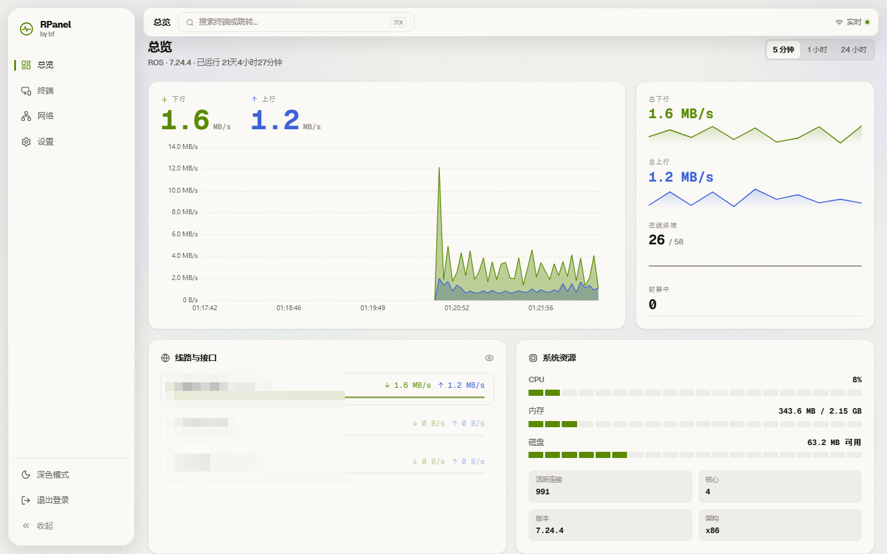
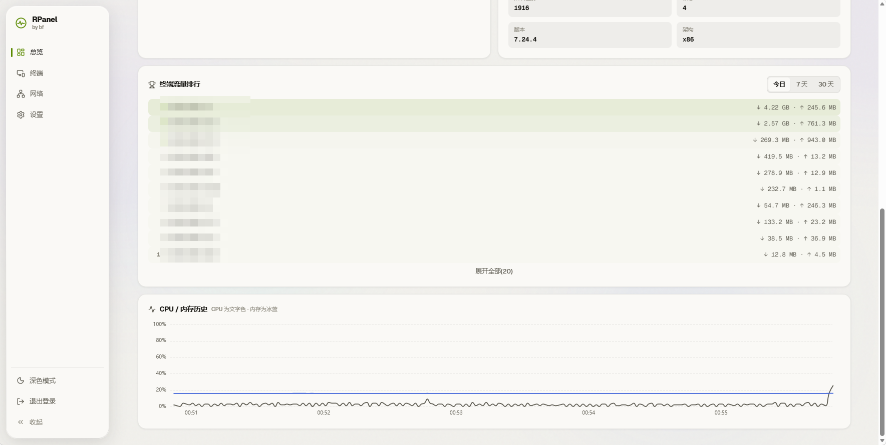
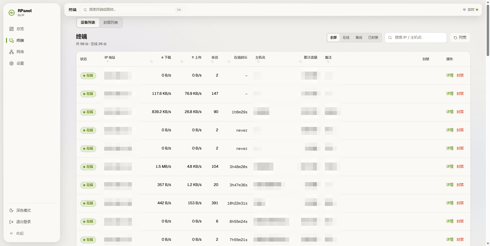
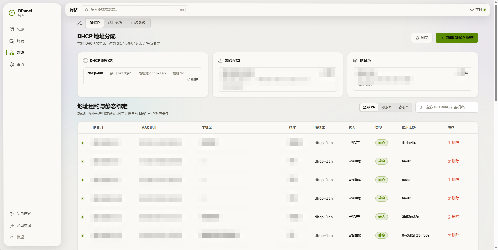
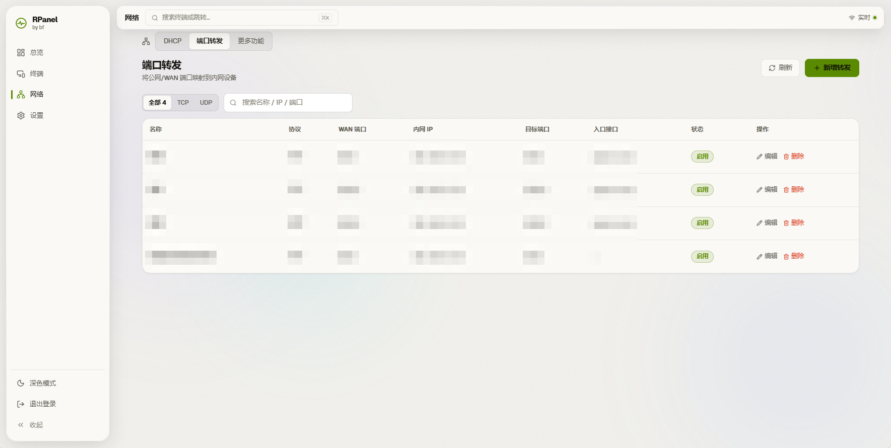
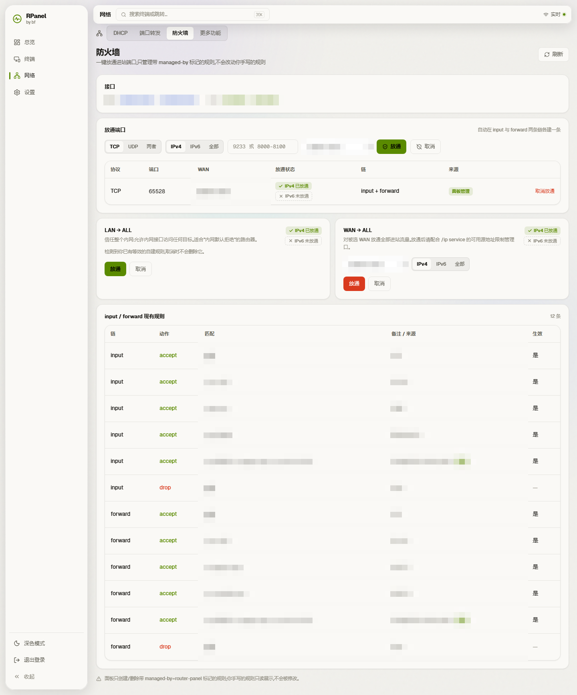
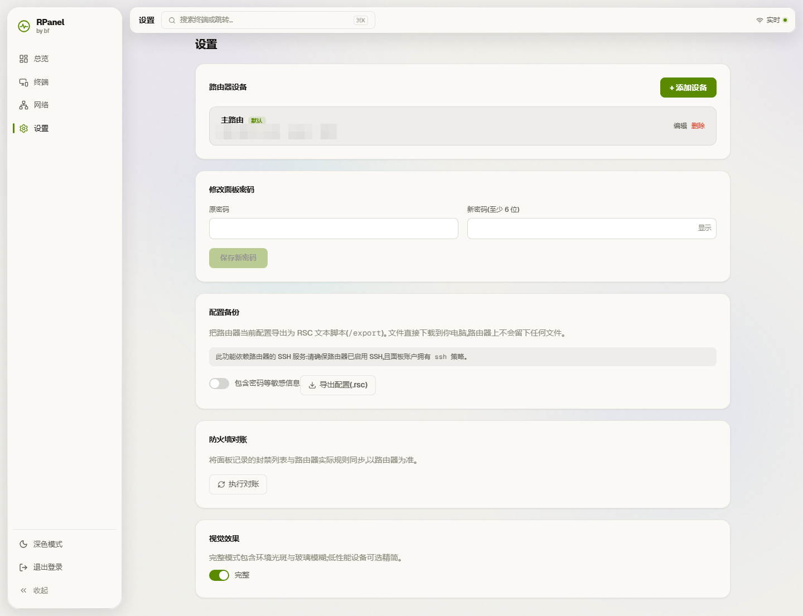
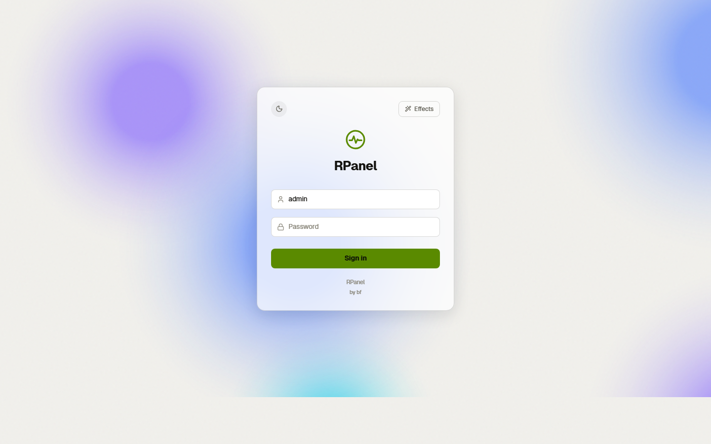

# RPanel



**RPanel** 是一个面向家庭内网的 MikroTik RouterOS 7 管理面板，用于实时查看终端、流量、DHCP、端口转发与防火墙，并支持一键封禁。

全部功能只在内网运行，不依赖云服务。

---

## 功能

### 实时总览


- 上下行实时速率与历史曲线
- CPU / 内存 / 磁盘
- 在线终端与封禁数量
- 多 WAN 线路识别与流量展示

首页下方的系统状态与流量排行：



- 终端流量排行，支持今日 / 7 天 / 30 天
- CPU 与内存历史曲线

### 终端监控



- 每台设备的上下行速率、会话数、在线时长
- 支持按状态、主机名、IP 搜索与排序
- 一键封禁 / 解封

### DHCP 管理



- 一键创建 DHCP 服务
- 地址池、网段、服务器、租约编辑
- 动态租约一键转静态

### 端口转发



- 表格式查看端口转发规则
- 新增 / 编辑 / 删除
- 接口下拉选择

### 防火墙



- 一键放通外部进来的端口，自动在 input / forward 两条链各建一条规则
- 按 WAN 口生效，IPv4 / IPv6 独立选择；IPv6 写入独立的 `/ipv6/firewall/filter`
- 常见场景一键放通 / 取消：LAN → ALL、WAN → ALL（含 IPv4 / IPv6 开关）
- 识别路由器上已有的等效规则；只创建和删除带 `managed-by=router-panel` 标记的规则，手写规则只读展示

### 系统设置



- 面板密码修改
- 路由器设备绑定
- 配置备份：一键导出 RSC 脚本，直接下载到本机
- 防火墙对账
- 视觉效果切换

---

## 一键部署

**整个部署只需要一个 `docker-compose.yaml`。** 不需要 `.env`，不需要 `Dockerfile`，
不需要源码或任何其它文件。

把下面内容保存为 `docker-compose.yaml`：

```yaml
services:
  rpanel:
    image: zmomo923/rpanel:latest
    container_name: rpanel
    restart: unless-stopped
    ports:
      - "8990:8000"        # 左侧改成你想用的端口
    volumes:
      - "./data:/data"     # 左侧改成你想保存数据的目录
```

### 启动

启动：

```bash
docker compose up -d
```

获取首次密码（首次启动时随机生成，只写进日志，不会落成任何密码文件）：

```bash
# Linux / macOS
tail -n 200 ./data/logs/routerpanel.log | grep "首次登录"
```

```powershell
# Windows PowerShell
Select-String -Path .\data\logs\routerpanel.log -Pattern "首次登录"
```

登录地址：

```text
http://<你的服务器IP>:8990
```

登录页：



---

## 数据目录结构

```text
data/
├── routerpanel.db        # 数据库
├── routerpanel.db-wal
├── routerpanel.db-shm
├── secret.key            # 加密密钥，必须备份
└── logs/
    └── routerpanel.log   # 系统日志，首次密码在这里
```

整个 `data/` 目录就是全部持久化数据，备份这个目录即可。

---

## 路由器准备

RPanel 通过 RouterOS REST API 或 SSH 控制 RouterOS 7。

### REST 模式（推荐）

在 RouterOS 中执行：

```routeros
/certificate add name=panel-cert common-name=panel
/certificate sign panel-cert
/ip service set www-ssl certificate=panel-cert disabled=no
```

限制只能从内网登录（三个私网段）：

```routeros
/ip service set www-ssl address=192.168.0.0/16,172.16.0.0/12,10.0.0.0/8
```

面板绑定时选择：

- 协议：REST
- 端口：443
- 校验 HTTPS 证书：上面用 `/certificate sign` 生成的是自签证书，保持不勾选即可正常连接；
  只有当你给路由器换成受信任 CA 签发的证书时，才勾选它做严格校验

### 创建专用用户

不要使用 RouterOS 管理员账号。

普通监控 / DHCP 查看用户：

```routeros
/user add name=panel password=你的密码 group=read
```

需要绑定设备 / 封禁 / DHCP 管理 / 端口转发时，用户必须有 `write` 权限：

```routeros
/user group add name=panel-rw policy=read,write,api,rest-api
/user add name=panel password=你的密码 group=panel-rw
```

---

## 安全特性

- 登录密码 Argon2 哈希
- 路由器凭据 AES-256-GCM 加密
- 登录失败限流与锁定
- WebSocket 鉴权
- RouterOS 命令参数白名单
- 端口转发只允许私网目标
- 写操作审计日志
- 应用进程以非 root（uid 1000）运行；容器入口只在启动瞬间修正数据目录归属，随即降权

---

## 作者

by bf
